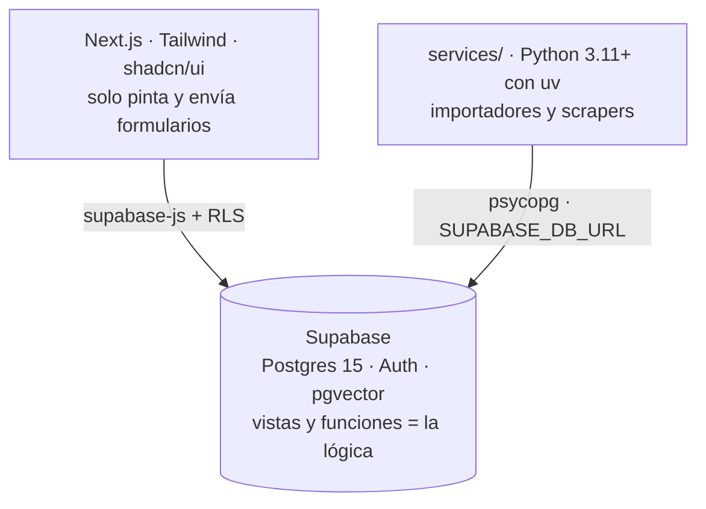

# AGENTS.md

Guía para agentes y colaboradores: estructura, comandos, mapa de SQL y cómo verificar cambios. Lo que explica **qué es** el proyecto y cómo arrancarlo está en el [README](./README.md); las **reglas duras** (cada una nacida de un error real) están en [CLAUDE.md](./CLAUDE.md), que se carga junto a este archivo. Léelos antes de tocar nada.

## Arquitectura



- **Frontend:** Next.js (App Router), TypeScript, Tailwind, shadcn/ui. Server Components por defecto. Desplegable en Vercel.
- **Datos:** Supabase. Migraciones en `supabase/migrations/`. RLS en todas las tablas; todas las vistas con `security_invoker = true`.
- **Servicios:** Python con `uv` y SQL directo con `psycopg` (sin ORM). Se ejecutan a mano, nunca en Vercel.

## Estructura del repositorio

```
/app             Páginas (App Router): foods, recetas, semana, compra, objetivos, peso, login
/components      UI. shadcn/ui + composiciones propias. Sin lógica de negocio.
/lib             Cliente Supabase, tipos generados, fechas (dates.ts), auth (requireUser)
/services
  /nutrition     insert_bedca.py (catálogo), apply_seed.py (seeds), import_bedca.py
  /scrapers      dia.py, load_dia_products.py, load_glovo_channel.py, dia_images.py, basket.py
  /tests         pytest (hoy: la cesta de la compra)
/supabase
  /migrations    Esquema versionado
  /seed          Datos de ejemplo sintéticos (01_staples.sql, 02_example_recipes_and_targets.sql)
/docs
  PLAN.md        Hoja de ruta y estado de las fases
  PROVIDERS.md   Tiendas y canales: qué hay, qué está fijado a Dia, cómo añadir una
  NOTES_infra.md Notas de infraestructura (pausa de Supabase gratuito)
```

## Comandos

```bash
pnpm dev                            # frontend local
pnpm build && pnpm start            # build de producción
pnpm lint
pnpm typecheck                      # antes de cada commit
supabase migration list             # solo lectura: seguro sin pedir permiso
supabase db push                    # aplica migraciones al proyecto enlazado (cloud)
supabase gen types typescript --linked > lib/database.types.ts   # tras cambiar el esquema
cd services && uv run pytest        # tests de Python
uv run services/nutrition/insert_bedca.py   # catálogo de alimentos (BEDCA), una vez por base
uv run services/nutrition/apply_seed.py     # datos de ejemplo (necesita un usuario creado en Supabase)
```

**Nunca `supabase start` ni `supabase db reset`** (regla dura 10): `db reset` contra el proyecto enlazado borra la base entera. El agente **no ejecuta `supabase db push` por iniciativa propia**: prepara la migración y para; la aplica solo cuando el usuario lo pide, tras revisarla.

Si un comando de esta sección no funciona, es un bug del documento, no del entorno: arréglalo aquí antes de seguir.

`pnpm typecheck` falla en un checkout limpio con `Cannot find name 'LayoutProps'` en `app/layout.tsx`: es un tipo global que Next genera en `.next/types` al arrancar `next dev`/`next build`. No es un error de tu cambio.

## Mapa de SQL

Toda la aritmética vive aquí (regla 1). Antes de calcular algo en TypeScript, busca si ya existe.

| Objeto | Qué calcula |
|---|---|
| `recipe_macros`, `compute_recipe_macros` | Macros totales y por ración de una receta. Usan `carbs_total_100g`, nunca `carbs_100g`. |
| `recipe_fit` | Cuánto se desvía una receta del arquetipo de plato (`protein_per_100kcal`, `fat_pct_kcal`). |
| `foods_energy_check` | Marca alimentos energéticamente imposibles (`energy_impossible`). |
| `create_meal_plan(week_start)` | Crea el plan de la semana resolviendo el objetivo vigente. |
| `meal_plan_slot_details` | Huecos del plan con receta, variante casa/oficina y `variant_mismatch`. |
| `plan_balance` | Raciones producidas frente a consumidas. |
| `plan_day_totals` | Macros por día, con comidas fuera de casa y huecos vacíos. |
| `save_week_as_rotation`, `apply_rotation` | Rotaciones semanales (**sin pantalla** todavía). |
| `plan_cook_batches`, `shopping_list` | Tandas a cocinar y lista de la compra por envases enteros, con sobrantes. |
| `plan_prorated_cost`, `plan_cost_summary` | Coste prorrateado por lo que se usa realmente. |
| `cheapest_dia_proposal` | Ranking de productos por céntimos por gramo de proteína, con avisos de comparación no fiable. |
| `channel_order_cost` | Coste de un pedido por canal, con comisiones. |
| `gross_salary_equivalent` | Euros brutos equivalentes a un importe neto (constante 0,30, ver README). |
| `normalize_search_name` | Trigger que rellena `search_name` (regla 11). |

## Cómo verificar un cambio

| Cambio | Comprobación |
|---|---|
| TypeScript | `pnpm typecheck` y `pnpm lint`. |
| Python | `cd services && uv run pytest`. |
| Migraciones o seeds | Aplicarlos sobre una base **vacía** (ver abajo). Es lo único que detecta que un clon nuevo no arranca. |
| Scrapers | No se prueban contra la tienda (regla 9). Prueba la lógica con datos guardados. |

### Probar migraciones en una base vacía sin Docker

Docker y el stack local están vetados (regla 10). Un Postgres embebido en Node basta, **fuera del repo y sin añadir dependencias**:

1. En una carpeta temporal: `npm i @electric-sql/pglite @electric-sql/pglite-pgvector`.
2. Crea una instancia con las extensiones `vector`, `unaccent` y `pgcrypto`.
3. Simula lo mínimo de Supabase: roles `anon`, `authenticated`, `service_role`; esquema `auth` con tabla `auth.users` y función `auth.uid()`.
4. Aplica `supabase/migrations/*.sql` en orden. Debe terminar sin errores.
5. Para los seeds: inserta un usuario en `auth.users`, importa los alimentos de BEDCA (`import_bedca.transform_all(RAW_XML_PATH)`) y ejecuta `supabase/seed/*.sql`; después reejecútalos (idempotencia).

Tarda en torno a dos minutos: lánzalo en segundo plano. Así se detectó que 4 migraciones rompían en una base nueva.

## Higiene de git

- **Usa el correo `noreply` de GitHub como autor** (`<id>+<usuario>@users.noreply.github.com`), no el real. Un incidente real: commits hechos por un agente con la config global de git subieron un correo personal al historial. Comprueba `git config user.email` antes de commitear, y activa en GitHub *Settings → Emails → "Block command line pushes that expose my email"*.
- **Las referencias de los PR (`refs/pull/*`) no se pueden borrar.** Si un commit con datos personales llega a un PR, reescribir `main` no lo retira: sigue descargable. No pushees datos sensibles ni "para borrarlos luego".
- `gitleaks` corre en pre-commit y en CI sobre todo el historial (`brew install gitleaks`, `pre-commit install`).
- Nunca imprimas el contenido de un `.env` por stdout. Para ver si una variable existe: `[ -n "$VAR" ] && echo "OK"`.

## Limitaciones técnicas

- **Vistas fijadas a Dia:** `cheapest_dia_proposal`, `shopping_list`, `plan_prorated_cost` y `plan_cost_summary` filtran `store = 'dia'`. Para otra tienda hace falta una tabla de ajustes y recrear esas vistas. Pasos y estado en [docs/PROVIDERS.md](./docs/PROVIDERS.md).
- **`StoreAdapter` no existe:** Dia es un módulo plano.
- **Catálogo compartido:** 8 tablas (`foods`, `recipes`, `recipe_ingredients`, `products`, `product_prices`, `channels`, `channel_fees`, `exercises`) tienen política `using (true)` para cualquier usuario autenticado (`20260911000000_shared_catalog.sql`). Seguro solo con el registro público desactivado.
- **`is_staple` y `is_excluded`** existen en `foods`, pero ninguna pantalla los usa para filtrar: son convención y datos, no restricciones aplicadas.
- **Matching alimento ↔ producto:** manual, vía `basket.json`. La columna de embeddings está en el esquema; el matching automático no existe.
- **Importadores:** solo BEDCA. No hay Open Food Facts.
- **Constantes pendientes de parametrizar:** el 0,30 de IRPF (`gross_salary_equivalent` y texto de `/compra`), y el alias `todayInMadrid()` frente a `todayInAppTimezone()`.
