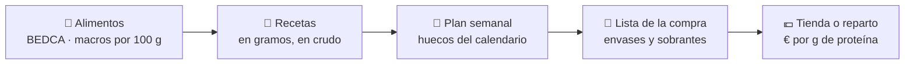
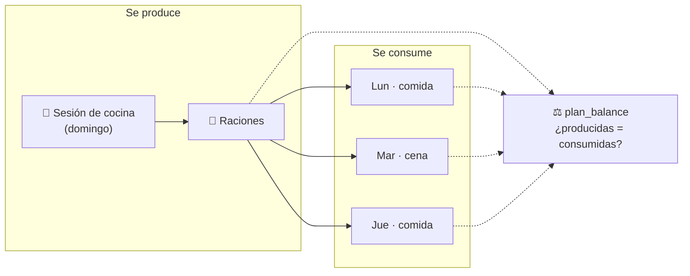

<div align="center">

# 🥩 Omnium

**Come lo que necesitas, al menor coste.**
Planifica la semana, calcula los macros en gramos y descubre cuánto te cuesta cada gramo de proteína.


</div>

> **Estado:** proyecto personal publicado como código abierto, no un producto. Pensado para una persona (o un grupo pequeño de confianza) con **su propia** base de datos Supabase. Hoy hay scraper para Dia (y el canal Glovo): lee las [limitaciones](#limitaciones) antes de empezar.



## Índice

[Qué aporta](#qué-aporta) · [Pantallas](#pantallas) · [Arranque](#arranque-paso-a-paso) · [Configuración](#configuración) · [Hacerlo tuyo](#hacerlo-tuyo) · [Datos y licencia](#datos-de-terceros-y-licencia) · [Limitaciones](#limitaciones) · [Contribuir](#contribuir)

---

## Qué aporta

| | Lo que hace distinto a Omnium |
|---|---|
| 💶 | **Optimiza €/g de proteína, no calorías.** Si quieres ganar músculo, minimizar calorías es lo contrario de lo que buscas. |
| 🍲 | **Cocinas un día y comes durante varios.** Producción y consumo están desacoplados. |
| 🛒 | **Compra sin desperdicio.** Cuántos envases, cuánto sobra, cuánto cuesta lo que realmente usas. |
| 🔍 | **Nunca finge saber lo que no sabe.** "No lo sé" y "cero" son cosas distintas en la base de datos. |
| 🚚 | **¿Compensa pedir a domicilio?** Compara tienda y reparto con comisiones reales. |
| 🧮 | **La lógica vive en SQL y Python**, donde se puede leer y auditar, no en el frontend. |

### 💶 Céntimos por gramo de proteína, no €/kg

Una app de dieta minimiza calorías. Aquí se compara por **lo que cuesta cada gramo de proteína** (ejemplo ilustrativo, números inventados):

```
Pechuga de pollo      6,50 €/kg · 22 g/100 g   ███ 2,95 cént./g
Solomillo de ternera 22,00 €/kg · 20 g/100 g   ███████████ 11,00 cént./g
```

Por €/kg la ternera es 3,4 veces más cara; por gramo de proteína, casi 4. El orden puede incluso invertirse entre un producto barato pero flojo en proteína y otro caro pero concentrado. La vista `cheapest_dia_proposal` ordena así los candidatos y **marca cuándo la comparación no es de fiar**.

### 🍲 Batch cooking: se cocina un día, se come en otros

La mayoría de planificadores asumen que cocinas y comes el mismo día. Aquí no:



Te dice si has cocinado de más o de menos, cuenta las comidas **fuera de casa** y los huecos vacíos, para no darte un falso déficit.

### 🔍 Datos honestos

| Dato | Cómo lo trata |
|---|---|
| Carbohidratos (con o sin fibra) | La fuente mezcla ambas convenciones. Cada fila lleva `net`, `total` o `unknown`, solo por prueba aritmética. |
| Energía imposible | Se detectan alimentos cuya grasa y proteína ya superan sus calorías declaradas. |
| Crudo o seco | Todo se pesa en crudo: un "hervido" con más calorías que el crudo es imposible y delata datos en base seca. |
| Precios | Cada uno es `scraped` (observado), `estimated` (calculado) o `manual`. Nunca se mezclan sin decirlo. |
| Conservas, legumbres, cortes | El peso del envase no es el del alimento (líquido, hueso, piel). Se confirma **a mano**, nunca se infiere. |

Cada una está explicada, con el error real que la motivó, en las [reglas de `CLAUDE.md`](./CLAUDE.md).

### 🚚 ¿Compensa pedir a domicilio?

Si tienes saldo de una tarjeta de beneficios que solo sirve en reparto (tipo Cobee), la pregunta es si el recargo de Glovo o Uber Eats se come el ahorro fiscal. La app guarda el precio por canal, las **comisiones** (suelo, porcentaje, techo) y calcula el coste total de un pedido. *Opcional: si compras solo en tienda, ignóralo.*

---

## Pantallas

| Pantalla | Para qué |
|---|---|
| `/foods` | Catálogo de alimentos con macros por 100 g y alta manual desde una etiqueta. |
| `/recetas` | Recetas en gramos, con macros por ración calculados en Postgres. |
| `/semana` | Planificador: asigna recetas a huecos, ve los macros del día frente a tu objetivo. Variantes casa / oficina con aviso. |
| `/compra` | Lista de la compra: envases, sobrantes, coste prorrateado y comparación de canales. |
| `/objetivos` | Histórico de objetivos (kcal, proteína, grasa, carbohidratos). |
| `/peso` | Registro de peso corporal. |

---

## Arranque paso a paso

Vas a montar **tu propia instancia**: tu proyecto de Supabase, tus claves, tus datos. Necesitas **Node 22.13+** con [pnpm](https://pnpm.io/), **Python 3.11+** con [uv](https://docs.astral.sh/uv/), la [CLI de Supabase](https://supabase.com/docs/guides/cli) y una cuenta gratuita de [Supabase](https://supabase.com/).

```bash
git clone https://github.com/Ventura14/omnium.git && cd omnium && pnpm install
```

<details>
<summary><b>1 · Crear tu proyecto de Supabase</b></summary>

En [supabase.com/dashboard](https://supabase.com/dashboard) crea un proyecto y apunta:

- **URL** y **clave pública** (`anon`/`publishable`): *Project Settings → API*.
- **Connection string** de Postgres: *Project Settings → Database → Connection string → "Session pooler"* (si la contraseña tiene `@ : / # %`, codifícalos en URL).
- La **referencia** del proyecto (`<ref>`): aparece en la URL del panel.
</details>

<details open>
<summary><b>2 · ⚠️ Desactivar el registro público (importante)</b></summary>

La app no tiene pantalla de registro, pero el endpoint de registro de Supabase Auth **está abierto por defecto** y la clave `anon` es pública. Varias tablas (alimentos, recetas, productos, precios, canales y comisiones) son un catálogo compartido que **cualquier usuario autenticado puede modificar**.

En el panel: *Authentication → Sign In / Providers* (el nombre varía según la versión) → desactiva **"Allow new users to sign up"**. Después crea tu usuario: *Authentication → Users → Add user*, con **Auto Confirm User**.
</details>

<details>
<summary><b>3 · Variables de entorno</b></summary>

```bash
cp .env.example .env.local            # URL y clave pública
cp services/.env.example services/.env  # connection string de Postgres
```

Detalle en [Configuración](#configuración). **Nunca imprimas un `.env`** (ni "solo para comprobar el formato"); para ver si una variable existe: `[ -n "$VAR" ] && echo "OK"`.
</details>

<details>
<summary><b>4 · Crear el esquema</b></summary>

```bash
supabase login
supabase link --project-ref <ref>
supabase migration list     # solo lectura: qué falta por aplicar
supabase db push            # aplica las migraciones a TU proyecto
```

> ⚠️ **Nunca `supabase db reset`**: contra un proyecto enlazado borra la base entera. Este proyecto trabaja contra Supabase en la nube; el stack local **no está probado**.

Las 50 migraciones están verificadas sobre una base **vacía**.
</details>

<details>
<summary><b>5 · Cargar alimentos y datos de ejemplo</b></summary>

```bash
uv run services/nutrition/insert_bedca.py   # ~950 alimentos de BEDCA, idempotente
uv run services/nutrition/apply_seed.py     # opcional: 35 alimentos base, 5 recetas [Ejemplo], 1 objetivo
```

Los datos de ejemplo son sintéticos: bórralos o edítalos. Si falta el usuario o BEDCA, el script se detiene y dice qué hacer.
</details>

<details>
<summary><b>6 · Arrancar</b></summary>

```bash
pnpm dev     # http://localhost:3000
```

Entra con tu usuario y recorre: `/objetivos` (pon el tuyo) → `/recetas` → `/semana` (crea el plan de la semana).
</details>

<details>
<summary><b>7 · (Opcional) Precios y despliegue</b></summary>

- **Precios:** para que `/compra` compare necesitas datos de una tienda. Hoy hay scraper para Dia, con reglas estrictas (1 petición/segundo): lee [docs/PROVIDERS.md](./docs/PROVIDERS.md) antes de lanzarlo.
- **Vercel:** importa el repo y define las mismas variables que en `.env.local` (y `APP_TIMEZONE` si no estás en Madrid).
- 💤 El plan gratuito de Supabase **pausa el proyecto tras 7 días sin actividad**; una app semanal vive al borde. Detalle en [docs/NOTES_infra.md](./docs/NOTES_infra.md).
</details>

---

## Configuración

| Variable | Dónde | Obligatoria | Para qué |
|---|---|---|---|
| `NEXT_PUBLIC_SUPABASE_URL` | `.env.local` | Sí | URL de tu proyecto. |
| `NEXT_PUBLIC_SUPABASE_ANON_KEY` | `.env.local` | Sí | Clave **pública**. La limita RLS. **Nunca pongas aquí la `service_role`.** |
| `APP_TIMEZONE` | `.env.local` y `services/.env` | No | Zona IANA de tus fechas. Por defecto `Europe/Madrid`. Un valor inválido falla a propósito. |
| `SUPABASE_DB_URL` | `services/.env` | Para los scripts | Postgres directo (rol `postgres`, salta RLS). **Solo scripts; nunca en el frontend ni en Vercel.** |

Los `.env*` están en `.gitignore`; solo se versionan los `.env.example`.

## Hacerlo tuyo

| Qué | Dónde |
|---|---|
| Tu **objetivo** (kcal, proteína, grasa, carbohidratos) | `/objetivos`. Histórico: nunca se sobrescribe. Se fecha en **lunes**. |
| Tus **recetas** | `/recetas`. Borra las `[Ejemplo]`. |
| Tu **catálogo de trabajo** (`is_staple`) | Marca en `foods`. El seed marca 35 de partida; cámbialos. |
| Tu **cesta de la compra** (qué busca el scraper) | `services/scrapers/basket.json`, fuera de git. Parte de `basket.example.json`. |
| Las **comisiones de tu plataforma de reparto** | Lista `FEES` de `load_glovo_channel.py`. Las que trae son de una dirección concreta: cámbialas por las que Glovo te muestra antes de pagar. |
| Tu **tipo marginal de IRPF** | Constante `0,30` en la función SQL `gross_salary_equivalent` y en el texto de `/compra`. Es una estimación ilustrativa: cámbiala con una migración. |
| Tus **días de oficina** | Tabla `work_location` (el seed no la rellena). |
| Tus **restricciones alimentarias** | Sin filtro automático: se respetan eligiendo qué alimentos y recetas tienes. |

## Datos de terceros y licencia

El **código** es [MIT](./LICENSE). **Los datos no son de este proyecto** y MIT no los cubre:

- **Alimentos:** [BEDCA](https://www.bedca.net/) (AESAN). El volcado está en `services/nutrition/data/`; consulta sus condiciones.
- **Supermercados:** muestras de sondeo de Dia y Mercadona (`services/scrapers/data/*_sample.json`) y miniaturas de Dia (`public/products/`) son datos de esas empresas, incluidos como ejemplo. Si eres titular y prefieres que se retiren, abre una *issue*.
- **Tu uso:** si ejecutas los scrapers, respeta los términos de uso y la protección anti-bot de cada tienda.

No es asesoramiento dietético, médico ni fiscal: valida tus objetivos con un profesional.

## Limitaciones

- **Tiendas:** scraper y vistas de precios están **fijados a Dia**; otra tienda requiere tocar vistas ([PROVIDERS.md](./docs/PROVIDERS.md)). La clase `StoreAdapter` **no existe todavía**.
- **Pocas personas de confianza:** el catálogo lo edita cualquier usuario autenticado; con registro público abierto no es seguro.
- **Solo Supabase en la nube**, y solo en español.
- **Sin Open Food Facts:** solo BEDCA; las marcas se dan de alta a mano.
- **Los scrapers dependen de webs ajenas:** si Dia cambia, se rompen.

Más detalle técnico en [AGENTS.md](./AGENTS.md).

## Contribuir

Lee **[AGENTS.md](./AGENTS.md)** (estructura, comandos, cómo verificar) y **[CLAUDE.md](./CLAUDE.md)** (reglas duras, cada una nacida de un error real). Hoja de ruta en [docs/PLAN.md](./docs/PLAN.md).
